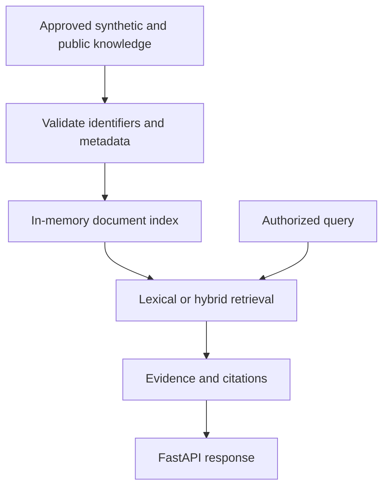

# Enterprise Data & RAG Architecture

## Scope

This phase provides a working FastAPI retrieval service on synthetic operational
documents. The API supports document indexing, lexical retrieval by default,
optional real sentence-transformer vector embeddings and weighted hybrid ranking,
source excerpts and demo classification filtering.

It intentionally uses a **retrieval-only response**, not an LLM-authored answer.
The `/v1/answer` endpoint returns evidence, never a hallucinated conclusion.

## Flow



## Run locally

```bash
python -m venv .venv
source .venv/bin/activate
pip install -e '.[dev]'
uvicorn aegis.main:app --reload
curl -X POST http://127.0.0.1:8000/v1/answer \
  -H 'content-type: application/json' \
  -H 'x-aegis-role: reader' \
  -d '{"query":"UPS battery temperature"}'
pytest -q
```

Real vector embeddings are opt-in: `AEGIS_EMBEDDINGS=sentence-transformers`.
This downloads a public model on first use. Default mode uses lexical scoring only;
do not describe default mode as semantic search.

## Production decision records to develop

- Replace unverified role header with signed enterprise identity and document-level ACLs.
- Use Azure AI Search (hybrid index) and immutable document identifiers.
- Add managed embeddings/model gateway, prompt-injection boundaries, and grounded generation.
- Attach document version, publication date, tenant and permissions to each chunk.
- Add evaluation dataset, Recall@k, groundedness, freshness and model-cost metrics.
- Add Azure tracing, rate limits, logging redaction and CI/CD.

## Boundaries

This repo must not include proprietary Vertiv or financial-services data.
Synthetic equipment records are not authoritative maintenance advice.
No automated control actions are supported.
